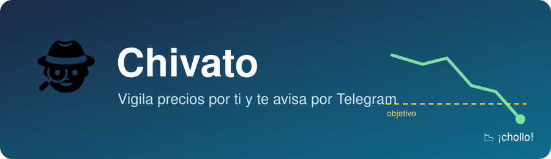
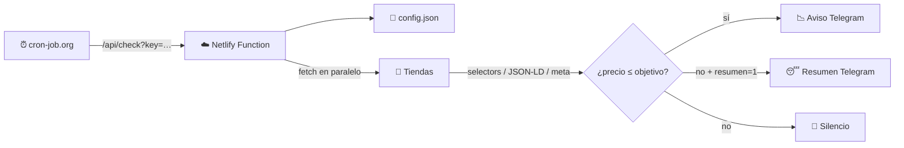

<p align="center">
  
</p>

<p align="center">
  
  
  
  
</p>

<p align="center">
  <b>Revisa varias tiendas (todos los colores de cada producto) y te avisa por Telegram cuando algo baja del precio objetivo.</b>
</p>

---

## ✨ Qué hace

- 🏬 **Varias tiendas a la vez**: ShopDutyFree, El Corte Inglés, MediaMarkt, K-Tuin…
- 🎨 **Todos los colores**: compara cada variante y te dice cuál es la más barata.
- 📉 **Solo avisa cuando merece la pena**: cuando el precio está en tu objetivo o por debajo.
- 😴 **Resumen diario opcional**: aunque no haya chollo, te dice cuál es el precio más bajo del momento.
- ☁️ **Sin servidor**: corre en Netlify Functions y lo lanza un cron gratuito.

## 📱 Así llega a Telegram

> 🕵️ **Chivato**
>
> 📉 **iPad A16 11" 128GB Wi-Fi** (objetivo 380,00 €)
>
> 🏬 **ShopDutyFree**
> &nbsp;&nbsp;369,90 €: [Plata](#) · [Azul](#)
>
> 🏬 **MediaMarkt**
> &nbsp;&nbsp;379,00 €: [Rosa](#)

Si no hay nada (con `resumen=1`):

> 😴 **GXTrust Xyra Teclado Mecánico** (objetivo 40,00 €): no hay precio objetivo.
> Más barato ahora:
> 🏬 **Amazon**
> &nbsp;&nbsp;49,99 €: [Blanco](#)

## ⚙️ Cómo funciona



1. Lee `config.json` (productos, precio objetivo, tiendas, URL por color).
2. Descarga cada página en paralelo y saca el precio, en este orden:
   - `selectors` CSS de la tienda, si los tiene definidos
   - JSON-LD (`Product` / `offers`)
   - meta tags (`itemprop="price"`, `product:price:amount`…)
3. Ignora los colores sin stock y ordena del más barato al más caro.
4. Si algo está en el objetivo o por debajo → 📉 aviso por Telegram con enlaces. Con `resumen=1` también avisa cuando no hay nada ("😴 no hay precio objetivo", con el más barato del momento y las tiendas que fallaron).

## 📋 Requisitos

- Node 22 o superior
- pnpm (o npm)
- Un bot de Telegram (créalo con [@BotFather](https://t.me/BotFather)) y tu chat id

## 🚀 Puesta en marcha local

```sh
pnpm install
cp .env.example .env   # rellena TELEGRAM_BOT_TOKEN y TELEGRAM_CHAT_ID
pnpm test-telegram     # envía un mensaje de prueba
pnpm check             # revisa precios y muestra el mensaje sin enviarlo
pnpm start             # revisa precios y envía el aviso
```

## 🔐 Variables de entorno

| Variable | Para qué |
|---|---|
| `TELEGRAM_BOT_TOKEN` | Token del bot (BotFather) |
| `TELEGRAM_CHAT_ID` | Chat donde llegan los avisos |
| `CHIVATO_KEY` | Clave secreta de la URL `/api/check` (solo en Netlify) |

## ➕ Añadir un producto

Añade un objeto a `products` en `config.json`:

```json
{
  "name": "Nombre que verás en Telegram",
  "targetPrice": 40,
  "stores": [
    {
      "name": "Tienda",
      "selectors": [".precio-final"],
      "colors": {
        "Negro": "https://tienda.com/producto-negro",
        "Blanco": "https://tienda.com/producto-blanco"
      }
    }
  ]
}
```

- `selectors` es opcional: solo hace falta si la página no trae JSON-LD ni meta tags de precio.
- Si un producto no tiene colores, usa una sola entrada (p. ej. `"Único": "https://..."`).
- Usa URLs limpias, sin parámetros de seguimiento (`ref=`, `smid=`…).
- Pruébalo con `pnpm check` antes de hacer deploy.

### 🧪 Tiendas probadas

| Tienda | Estado |
|---|---|
| ShopDutyFree, El Corte Inglés, MediaMarkt, K-Tuin | JSON-LD / meta |
| Amazon | ⚠️ Bloquea con captcha las peticiones desde Node (ver abajo) |

**Amazon:** desde Node (que es lo que usa Netlify) devuelve siempre la página de captcha, así que el producto aparece como "⚠️ Sin datos". Los `selectors` de `config.json` funcionan cuando la página sí carga. Para seguir precios de Amazon de forma fiable: alertas de [CamelCamelCamel](https://es.camelcamelcamel.com/) o la API de [Keepa](https://keepa.com/).

## ☁️ Deploy en Netlify

1. Conecta el repo en Netlify. No hay build: `netlify.toml` ya lo deja configurado (solo funciones, `public/` como estático).
2. En *Site settings → Environment variables* añade `TELEGRAM_BOT_TOKEN`, `TELEGRAM_CHAT_ID` y `CHIVATO_KEY`.
3. Tras cada deploy correcto, `deploy-succeeded.mjs` manda a Telegram un mensaje con la lista de productos.
4. Programa el cron externo:
   - `https://TU-SITIO.netlify.app/api/check?key=CHIVATO_KEY`: cada pocas horas, solo avisa si hay chollo.
   - `https://TU-SITIO.netlify.app/api/check?key=CHIVATO_KEY&resumen=1`: **una vez al día**, avisa siempre.

Si la clave es incorrecta, la URL responde 404. Cada página tiene un timeout de 8 s, porque la función de Netlify dispone de unos 10 s en total.

## 📁 Estructura

```
index.js                          lógica: scraping, informe, Telegram, CLI
config.json                       productos y tiendas
netlify/functions/chivato.mjs     endpoint /api/check (cron)
netlify/functions/deploy-succeeded.mjs  aviso tras deploy
public/index.html                 página estática
```
